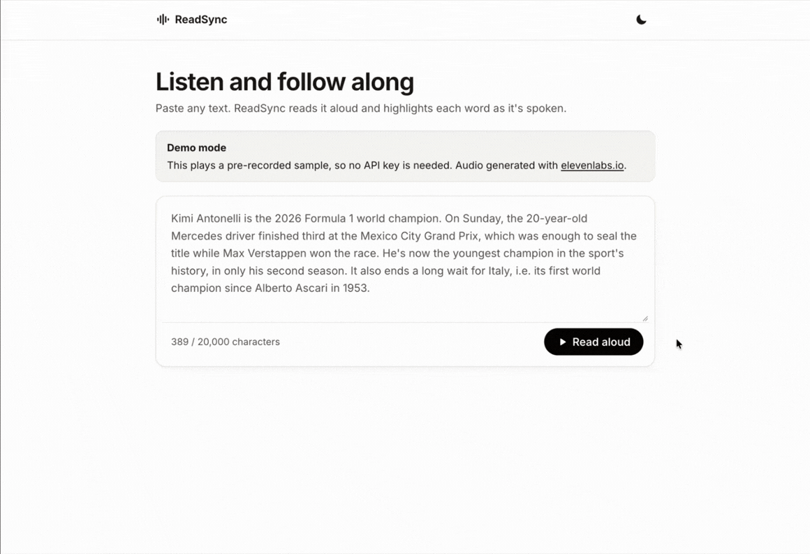

# ReadSync 📖

A read-along reader for people with **dyslexia** or **low vision**, built to work across languages.

Paste text, and ReadSync reads it aloud with an [ElevenLabs](https://elevenlabs.io) voice while highlighting each word as it is spoken. Click any word to jump there.



<sub>Recorded in [demo mode](#try-the-demo-no-api-key-needed-voice-by-elevenlabsio), which you can run without an API key. Voice by elevenlabs.io.</sub>

## Why 💡

For many readers, a page of text is the hard part, not the ideas in it. People with dyslexia spend effort decoding words and keeping their place in a line; people with low vision lose track of where they are as they move across a page. Listening alone helps, but it gives up the text: readers can't see how a word is spelled, skim back, or follow at their own pace.

ReadSync combines the two. The voice carries the reading, and the moving highlight ties every spoken word to the written one, so readers keep their place, see each word as they hear it, and can slow down, jump back or replay at will. The same pairing helps language learners connect pronunciation with spelling, which is why working across languages matters as much as the voice itself.

## What it does 📋

Today, the reader:

- Highlights the word being spoken, in sync with the audio.
- Reads long texts part by part: playback starts after the first sentence or two is ready, and the next part is generated while the current one plays.
- Lets readers pause, move by sentence, change the speed (0.75× to 1.5×, remembered between texts and visits) and jump to any word.
- Uses an off-white background, larger text, and wider letter, word and line spacing, which many dyslexic readers find easier than dense black-on-white text.
- Keeps line breaks from the original text, and shows a clear focus outline for keyboard users.
- Scrolls to the reader and moves focus to play/pause when reading starts, so keyboard users can pause with Space right away.
- Has a light/dark toggle that follows the system until changed and remembers the choice (dark mode uses a dark grey reading area rather than black, to reduce glare), respects reduced-motion settings, and keeps the player controls in view while scrolling a long text.
- Expands numbers, currencies and common abbreviations into natural speech ("£3,500.75", "i.e.").

Known gaps:

- Jumping to a specific word needs a mouse; keyboard users can move by sentence, but not word by word.
- Reading settings (font, size, colours, line focus) aren't adjustable yet.
- Abbreviation rules exist for English only, and words are split on spaces, which doesn't work for languages like Japanese.
- Texts are limited to 20,000 characters, as a guard on credits.

## How it works 👩‍🔬

ElevenLabs' [text-to-speech with timestamps](https://elevenlabs.io/docs/api-reference/text-to-speech/convert-with-timestamps) endpoint returns the audio together with a start and end time for every character. The server groups those character timings into words; the client follows the audio's playback position on every animation frame and highlights the word being spoken.

Long texts are split into chunks of whole sentences with `Intl.Segmenter`: a small first chunk so playback starts quickly, then chunks of about 800 characters. The client generates the chunk being played and the one after it, passes the neighbouring chunks to ElevenLabs as `previous_text` and `next_text` so the intonation carries across, and maps each chunk's word timings back onto the full text.

## Project layout 🏯

```
apps/
  server/   Fastify API — keeps the ElevenLabs key server-side, turns character timings into word timings
  web/      Vite + React reader UI
packages/
  shared/   API schemas and types, plus the sentence chunking and word splitting, used by both sides
```

## Getting started 🏃‍♀️

Requires Node 26.12.1+ and pnpm.

### Try the demo, no API key needed (voice by elevenlabs.io)

```bash
nvm use        # picks up the version in .nvmrc
pnpm install
pnpm dev:demo  # API on :8787, web on :5173
```

Open http://localhost:5173 and press **Read aloud**. Demo mode replays a sample that was recorded once from ElevenLabs ([`fixtures/demo.json`](apps/server/fixtures/demo.json)): real audio and word timings, so the reader behaves exactly as it does live, but nothing calls ElevenLabs and only the sample text can be read. The audio was generated with elevenlabs.io on the free plan, which allows non-commercial use with attribution.

### Run it with your own API key

```bash
cp apps/server/.env.example apps/server/.env   # then add your ElevenLabs API key
pnpm dev
```

Open http://localhost:5173.

### Optional: abbreviation dictionary

ElevenLabs doesn't reliably expand abbreviations like "e.g." ("for example"). To make it consistent, create an English pronunciation dictionary once and add its ID to `apps/server/.env`. The API key needs the Pronunciation Dictionaries permission (read and write) in addition to Text to Speech.

```bash
pnpm --filter @readsync/server dictionary:create en
```

The rules live in [`pronunciationRules.ts`](apps/server/src/modules/speech/pronunciationRules.ts), keyed by language. Only English exists so far, and every text is treated as English. Running the script again creates a new dictionary, so update the ID after changing the rules.

## Scripts 🤖

| Command                                               | What it does                                                                                |
| ----------------------------------------------------- | ------------------------------------------------------------------------------------------- |
| `pnpm dev`                                            | Run the API and web app in watch mode                                                       |
| `pnpm dev:demo`                                       | Same, replaying the recorded sample; no API key needed (macOS/Linux shells)                 |
| `pnpm test`                                           | Run the tests                                                                               |
| `pnpm typecheck`                                      | Type-check every package                                                                    |
| `pnpm --filter @readsync/server dictionary:create en` | Create a language's abbreviation dictionary in ElevenLabs                                   |
| `pnpm --filter @readsync/server demo:record`          | Re-record the demo sample from ElevenLabs (uses credits; `--dry-run` shows the chunks only) |

## Learnings 🧠

What I learned about ElevenLabs while building this, from text normalization to word timing, is in [docs/learnings.md](docs/learnings.md).
