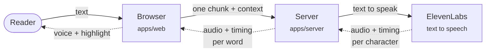
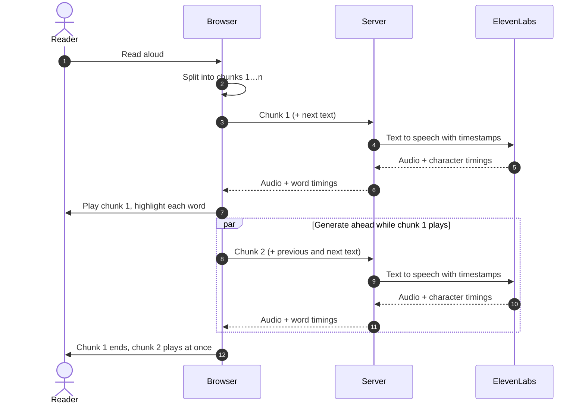

# Architecture

ReadSync is a TypeScript monorepo with three packages: a React client, a Fastify server that keeps the ElevenLabs API key private, and a shared package with the API's Zod schemas and the text-splitting logic both sides use.

## Overview

Solid arrows are requests; dashed arrows are what comes back. Each chunk of the text makes this round trip once.

- **The browser** splits the text into chunks of whole sentences, with a small first chunk so playback starts quickly. It plays one chunk while generating the next, and highlights the word whose start time the audio has passed, checking on every animation frame. A small cache makes sure the same request is never sent twice.
- **The server** validates each request, calls ElevenLabs, and turns the per-character timings into word timings with character offsets, so the browser can highlight the original text. In demo mode it replays recorded responses instead of calling ElevenLabs.
- **packages/shared** holds the Zod schemas both sides use for the API, and the sentence and word splitting, so the browser and the demo recording script split text the same way.
- **ElevenLabs** generates the audio and timings. Text normalization and the pronunciation dictionary expand things like "£3,500.75" and "i.e." in the spoken audio, while the timings still map to the text as written.

## One reading

Each chunk is generated just before it's needed: one chunk ahead is enough, because a chunk takes far longer to play than to generate. The neighbouring chunks are sent as context so the intonation carries across, and they aren't charged. The reasoning behind these choices, and the measurements that shaped them, are in [learnings.md](learnings.md).
